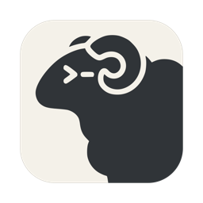
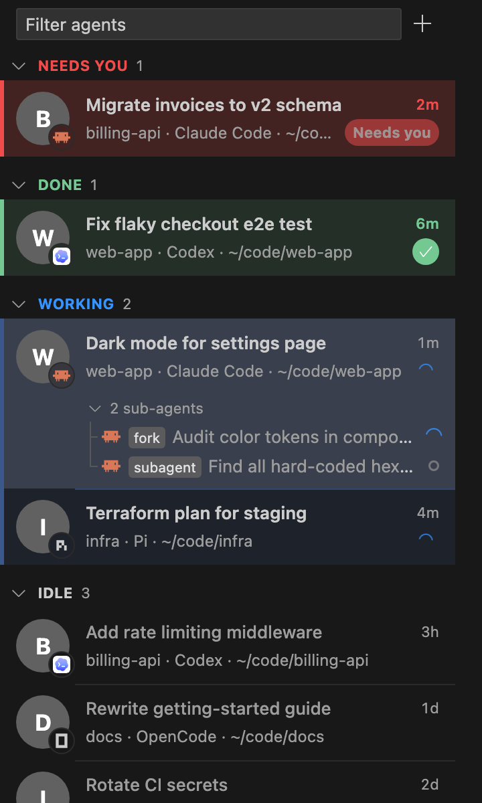
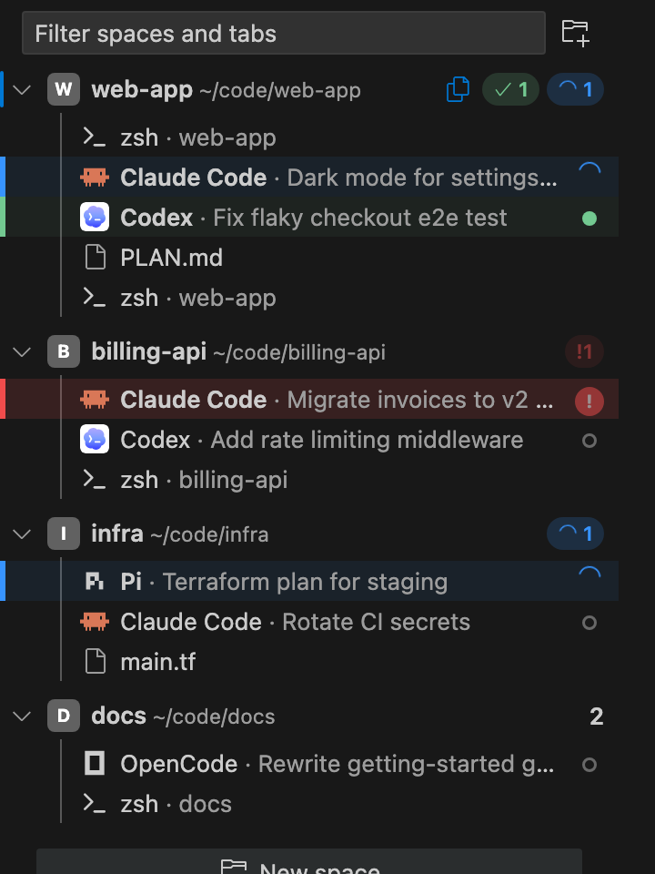
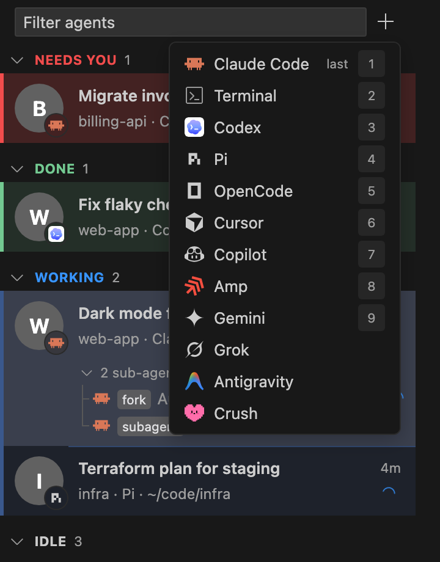

<p align="center">
  
</p>

<h1 align="center">Herdr for VS Code</h1>

<p align="center">
  Your <a href="https://github.com/herdrdev/herdr-app">herdr</a> spaces and coding agents, right in the VS Code sidebar.<br>
  See which agent needs you, jump into its terminal, start new ones — without leaving the editor.
</p>

<p align="center">
  <a href="https://github.com/mxprshn/herdr_vsx/releases/latest"><b>Download the latest .vsix</b></a>
</p>

<p align="center">
  
  &nbsp;&nbsp;
  
</p>

## What it does

**Agents** — every agent from your herdr spaces in one list, like a chat list:

- 🔴 **Needs you**, 🟢 **Done**, 🔵 **Working**, idle — each with its own color, sorted by what needs attention first.
- The repo's avatar with the agent's icon in the corner, its topic, space and how long it's been in that state.
- Sub-agents (`hc run` children and reported child records) nested under their parent.
- A badge on the activity bar, a status bar summary, a notification and herdr's sound when an agent needs you or finishes while you look elsewhere.
- When VS Code is in the background, a macOS banner with what the agent just said (its question, if it asked one) and the repo's avatar; clicking it opens that agent.
- Pin agents to the top, close their tab, filter, group by priority or by space.
- **Explyt agents:** duplicate one (forks its session, so the copy has the whole conversation), or double-click its title to rename the session.

**Spaces** — your herdr spaces as an Explorer-like tree: spaces with their tabs (terminals, agents, files) inside.

- The space you're working in is shown in the **Explorer** as an extra root, and follows you as you switch terminals.
- Files you open in VS Code become tabs of their space, and leave it when you close them.
- Git fetch / pull, new markdown note, rename, close — from the context menu.

**Terminals** open as VS Code editor tabs (or in the panel) and attach to herdr-core: closing the tab only detaches, the program keeps running. `Cmd+V` pastes screenshots into agents the way herdr does.

**Starting things** — the **+** opens a menu with Terminal and every agent herdr knows, with their icons; the one you used last comes first, number keys pick. New spaces start from this window's folders, your recent ones, or any path you type.

<p align="center"></p>

Everything goes through herdr-core, so the extension and the herdr app see the same spaces, tabs, agents, pins and “seen” state — use either, or both at once.

## Install

1. Install [herdr](https://github.com/herdrdev/herdr-app#install) (the app installs `herdr-core` too). You need `hc` — check with `hc --version`.
2. Download `herdr-vsx-<version>.vsix` from [Releases](https://github.com/mxprshn/herdr_vsx/releases/latest).
3. Install it:
   ```sh
   code --install-extension herdr-vsx-0.11.0.vsix
   ```
   or in VS Code: **Extensions → ⋯ → Install from VSIX…**
4. Open the **herdr** view in the activity bar.

If it says it can't reach herdr-core, set `herdr.hcPath` to the full path of `hc` (`which hc`).

## Shortcuts

| Keys (macOS / other) | |
|---|---|
| `Cmd+Alt+A` / `Ctrl+Alt+A` | Go to agent… |
| `Cmd+Alt+N` / `Ctrl+Alt+N` | Next agent that needs you |
| `Cmd+V` / `Ctrl+Shift+V` in a herdr terminal | Paste text or an image |

Command palette: **Herdr: New Agent**, **New Space**, **Go to Agent…**, **Reconnect to Core**.

## Settings

| Setting | Default | |
|---|---|---|
| `herdr.hcPath` | `hc` | Path to `hc`; also looks in `~/.local/bin`, `/opt/homebrew/bin`, `/usr/local/bin`. |
| `herdr.openIn` | `editor` | Open terminals as editor tabs or in the terminal panel. |
| `herdr.notifications` | `true` | Notify when an agent needs you or finishes. |
| `herdr.systemNotifications` | `true` | macOS banner when VS Code isn't focused. Install `terminal-notifier` (`brew install terminal-notifier`) for the avatar, the message and click-to-open. |
| `herdr.sounds` | `true` | Play herdr's sounds. |
| `herdr.explorerFollowsSpace` | `true` | Show the current space's project as an Explorer root. |
| `herdr.mascots` | `true` | Each harness's anime mascot as the agent's avatar, the repo in its corner. |
| `herdr.filesFollowEditors` | `true` | Mirror open files into their space (needs a herdr editor mod named `my-editor`). |

## Build from source

```sh
git clone https://github.com/mxprshn/herdr_vsx && cd herdr_vsx
npm ci
npm run compile
npx @vscode/vsce package          # → herdr-vsx-<version>.vsix
```

Press `F5` in VS Code to run it in an Extension Development Host.

How it works: the extension runs `hc connect` and speaks herdr-core's framed JSON-RPC (the same protocol herdr-app uses) — `events.subscribe` for live state, `terminal.attach` for terminal streams, and the shared `herdr-app` layout document for spaces and tabs. See [`src/core.ts`](src/core.ts) and [`src/state.ts`](src/state.ts).

## Notes

- Unofficial; not affiliated with the herdr project.
- Tested on macOS. Linux should work; Windows is untested.
- Splits inside a tab are listed, not laid out side by side.

## License

[MIT](LICENSE). Bundled herdr icons, program table and sounds are from [herdr-app](https://github.com/herdrdev/herdr-app) (Apache-2.0); see [THIRD-PARTY-NOTICES.md](THIRD-PARTY-NOTICES.md).
